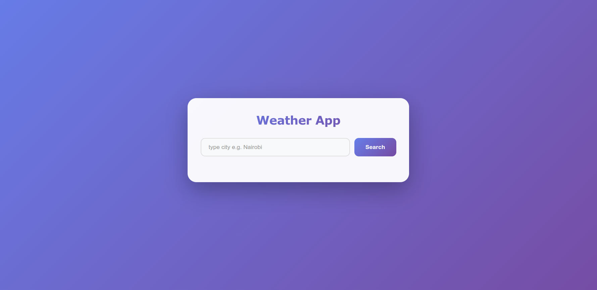

# Odin-Project-Weather-App
# 🌤️ Weather App

A modern, responsive weather application built with vanilla JavaScript that displays real-time weather information for any city worldwide using the WeatherAPI service.

## ✨ Features

- **Real-time Weather Data**: Fetches current weather conditions from WeatherAPI
- **City Search**: Search for weather information in any city globally
- **Comprehensive Weather Information**:
  - 📍 Location (City & Country)
  - 🕐 Last update time with timezone
  - 🌡️ Temperature in Celsius
  - 💨 Wind speed in mph
  - 💧 Humidity percentage
  - ☁️ Weather condition description
  - 🖼️ Weather condition icon
- **Responsive Design**: Optimized for all screen sizes (mobile, tablet, desktop)
- **Modern UI**: Clean gradient design with smooth animations
- **Error Handling**: User-friendly error messages for invalid cities or network issues

## 🛠️ Technologies Used

- **HTML5** - Semantic markup
- **CSS3** - Modern styling with animations and gradients
- **JavaScript (ES6+)** - Async/await, DOM manipulation
- **Webpack** - Module bundling and development server
- **WeatherAPI** - Third-party weather data API